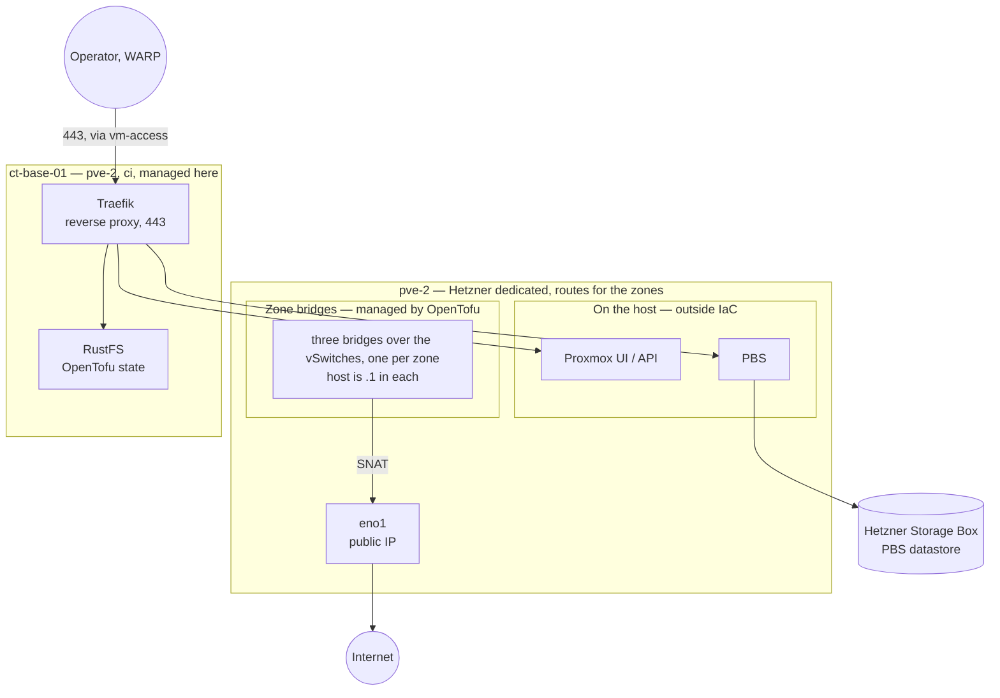
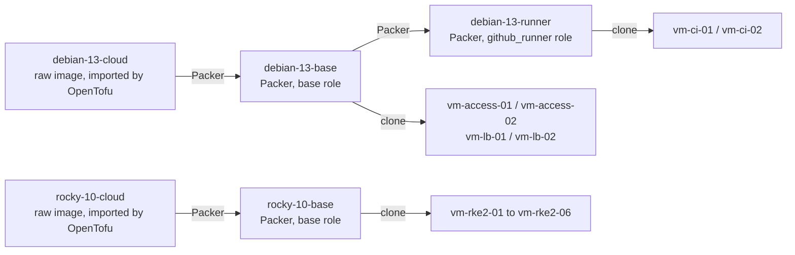
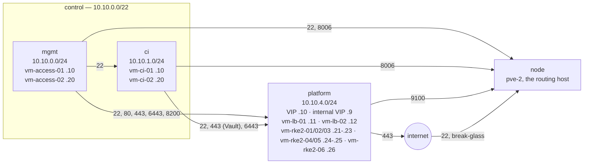
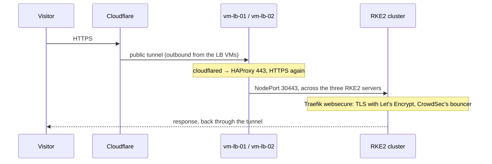
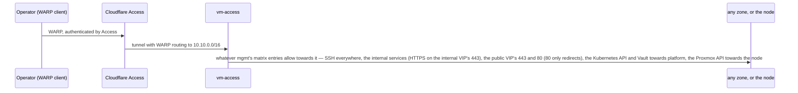
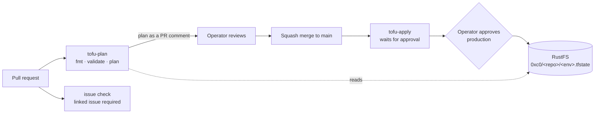
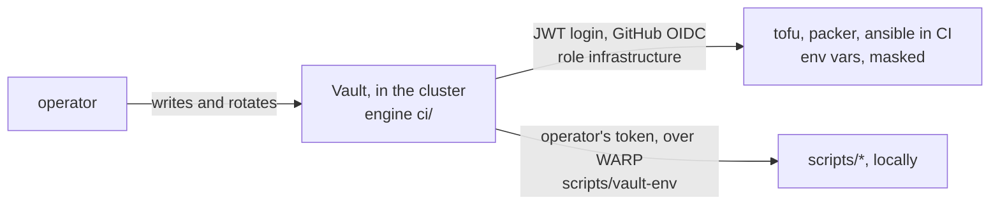

# Architecture

How the pieces fit together. The **decisions** behind them live in the
workspace's design, [`network`](https://github.com/0xc0-labs/workspace/blob/main/docs/design/network.md) and
[`platform`](https://github.com/0xc0-labs/workspace/blob/main/docs/design/platform.md); what was discarded, and why, in
[`discarded.md`](https://github.com/0xc0-labs/workspace/blob/main/docs/discarded.md).
The **network** is decided by the code, in
[`terraform.tfvars`](../environments/prod/terraform.tfvars), and explained in
[`zones.md`](zones.md). This document explains how it fits together; if it
disagrees with the code or with the design, they win.

## The node

Two Hetzner dedicated servers, Proxmox VE 9. `pve-1` (`pve.0xc0.cc`): 12 CPU,
62 GB RAM, two NVMe disks in mdadm RAID 1, reinstalled on 2026-11-25 and
rejoined to the cluster. `pve-2`: two NVMe disks in mdadm RAID 1.

They are the two nodes of a Proxmox cluster named `cluster`: no
QDevice and no HA, `pve-2` with 2 votes and `pve-1` with 1, so `pve-2` keeps
quorum alone. They talk over one corosync link on the vSwitch `cluster`
(`10.20.0.1` and `10.20.0.2`, [`zones.md`](zones.md#vswitches)), and both are in
`nodes`, each with its link interface and the same firewall rules from this
root. Every machine, VM and template names the node it runs on, its `node` in
`terraform.tfvars`: every one says `pve-2` while `pve-1` is away, so `pve-2`
runs every VM, RKE2 machine, container and template, and Packer builds there.
`pve-2` alone holds the zones' gateway and SNAT (`zone_gateways`) and runs PBS;
`pve-1`'s bridges are layer 2 only. The `sbox` storage is `server 10.20.0.2`, `pve-2`'s link address,
which both nodes reach. `pve-1` holds no guest yet and does not route for the
zones; it takes the role back, and its share of the guests, in the next steps
of workspace#285. The rest of this section
says which node each paragraph is about.

**Containers.** Beside the VMs there are LXC containers, the `containers` map in
`terraform.tfvars` (`modules/container`): unprivileged, in a zone like any
guest, with the same firewall on their NIC, from the same matrix, and in the
same daily backup. The first, `ct-base-01` on `pve-2` in `ci`, is where the
base services run in: Traefik and RustFS, configured from the pipeline. The
names `pve`, `pbs`, `s3` and `s3-console` reach it, from WARP and from the CI
VMs, and the nodes admit 443 from no zone.

**Moving a guest between nodes.** A guest moves live, with its disks, over the
link: `qm migrate <id> <node> --online --with-local-disks`, run by hand on its
node. The cluster's options set how: `secure`, over `node_link.cidr`, limited
to `migration_bandwidth_limit_mib`, since the vSwitch is 1 Gbit and shared with
every zone's traffic between the nodes. The code changes after the move, never
before: a VM whose `node` changes is replaced, and every VM carries
`prevent_destroy`, so a plan made before the move fails. After it, the `node`
is changed and the plan shows nothing. `migrate` is not set on the VMs, so that
no apply moves every one of them at once. A clone is made on the node of its
template, since `local` is a `dir` storage and Proxmox clones to another node
only from shared storage.



- **Base services** — PBS runs on `pve-2`'s host, with the Storage Box mounted
  there at `/mnt/pbs`; it is not managed by any repo in this org, and nothing
  here may touch it. `pve-1` has none. Traefik and RustFS run in
  `ct-base-01`, managed here: OpenTofu makes the container and Ansible
  configures what is inside it. That Traefik is only the reverse proxy of the
  Proxmox UI, PBS and RustFS; it is not the application ingress.
- **Storage** — `pve-2`: `local` on the NVMe RAID 1, with the system disks,
  and `sata` on the SATA SSDs' RAID 1, with Longhorn's data disks (150 GiB
  each, two per RKE2 node; [Storage `sata`](../README.md#storage-sata-on-pve-2)).
  `pve-1`: `local` alone, so its RKE2 nodes would keep their data disks there.
- **Disks** — both nodes are RAID 1. `pve-1` was RAID 0 until it was
  reinstalled on 2026-11-25 by the README's
  [Adding a node](../README.md#adding-a-node) and rejoined over the link with
  `pvecm add 10.20.0.2 --link0 10.20.0.1 --use_ssh`, since `pve-2`'s `root` has
  no password ([A node that rejoins](../README.md#a-node-that-rejoins)).
- **`eno1`** keeps the public IP. Guests never attach to it: Hetzner drops
  unknown MACs on the public interface. They live on the zones' bridges, and
  reach the internet through the SNAT on `pve-2`, to `142.132.139.52`.
- **The gateway**, by hand, on the node that routes for the zones, `pve-2`: in
  `/etc/network/interfaces` each zone's bridge is `inet static` with the `.1`
  and, for the zone, the SNAT and the conntrack zone rule (`zones.md`, Zones).
  The provider's resources keep those lines when they rewrite the file. On
  `pve-1` the bridges are `inet manual`, with the conntrack zone rule alone.
- **No node has Docker** (`pve-1`'s went with its reinstall).
  The zone firewall needs the `FORWARD` policy at ACCEPT on every node that
  hosts guests, not only the routing one: a guest's traffic crosses its
  firewall bridge on the node it runs on, through that node's `FORWARD` chain
  (`net.bridge.bridge-nf-call-iptables = 1`). Today that is `pve-2`, which
  hosts every guest, and `pve-1` once it takes its share back. The
  Proxmox firewall explicitly accepts only traffic *into* a VM. It leaves
  traffic *out of* a VM, and the hop across a zone bridge, to that policy, so
  a DROP takes every VM's egress and its peers (tested in
  [`#2`](https://github.com/0xc0-labs/infrastructure/issues/2)). Docker sets
  DROP, which is why a node that ran it needed `ip-forward-no-drop`; a node
  with no Docker, as both are, has ACCEPT by default. Being the routing node
  adds only forwarding (`ip_forward`) on top of that.
- **Forwarding**, also by hand, on a node that routes for the zones. Only the
  zones' bridges forward by themselves; the replies come in
  through `eno1`, whose forwarding follows `net.ipv4.ip_forward`, and no file
  sets it (Hetzner's `99-hetzner.conf` has it commented out). Without it a
  guest has its gateway and no internet. On `pve-2`, `/etc/sysctl.d/90-ip-forward.conf`:

  ```
  net.ipv4.ip_forward = 1
  ```

  A node with no Docker has nothing else that sets it, which a test guest
  showed on 2026-11-24. The provider cannot write the file and Ansible here
  configures VMs, not nodes.
- **`eno1`'s offloads**, also by hand: TCP and generic segmentation offload
  are off, with `post-up /usr/sbin/ethtool -K eno1 tso off gso off` in the
  `iface eno1 inet static` stanza of `/etc/network/interfaces`. The I219-LM
  (`e1000e`) hangs its TX ring with TSO on: on 2026-10-16 it logged
  `Detected Hardware Unit Hang` and the node was without network for 23
  minutes ([`#254`](https://github.com/0xc0-labs/infrastructure/issues/254)).
  GRO, the receive side, stays on. On a reinstalled node, add the line.
- **The MSS clamp**, also by hand, on the node that routes for the zones: in
  the same stanza, after the offload line,

  ```
  post-up iptables -t mangle -C FORWARD -p tcp --tcp-flags SYN,RST SYN -j TCPMSS --clamp-mss-to-pmtu 2>/dev/null || iptables -t mangle -A FORWARD -p tcp --tcp-flags SYN,RST SYN -j TCPMSS --clamp-mss-to-pmtu
  ```

  It rewrites the segment size of every forwarded TCP handshake to what the
  path carries, so a guest and its peer agree on 1360 from the first packet
  whatever MTU each believes it has. It was added before the zones' bridges
  went to MTU 1400 (#284, #287). The `-C` test makes it run once however many
  times the network reloads. The provider's API keeps the line when it
  rewrites the file. It reaches TCP only: QUIC, which the Cloudflare tunnels
  use, is not covered (`zones.md`, vSwitches).
- **Hetzner firewall**, in Robot, also by hand. It is stateless: a reply gets
  in only if an incoming rule matches it. TCP replies pass through the `ack`
  rule, UDP only for what is listed. Besides DNS and NTP (source ports 53 and
  123), cloudflared's QUIC needs **udp from `198.41.192.0/20`, source port
  7844, to ports 32768-65535**. Without it the tunnel falls back to HTTP/2
  ([`#37`](https://github.com/0xc0-labs/infrastructure/issues/37)). IPv6
  is not filtered there.

  Each server's firewall also carries two incoming rules for the private
  ranges, above its `deny all`: `zones` (IPv4, any protocol, source
  `10.10.0.0/16`) and `nodes-link` (IPv4, any protocol, source
  `10.20.0.0/24`), both accept. The firewall filters the vSwitches too, and
  without them only ICMP and TCP replies cross between the nodes: on
  2026-11-23, with the rules above alone, none of 200 UDP packets arrived and
  no TCP connection opened, in either direction. Each server uses 9 of the 10
  incoming rules Hetzner allows.

Some of these bullets hold only for one node, each for its own reason. PBS, because
`pve-2` runs it: it does not apply to a node installed without it, as in the README's
[Adding a node](../README.md#adding-a-node). Disks, because of the RAID level.
The forwarding is only for the node that routes for the zones, `pve-2`: the
gateway and SNAT are its own, and a guest on another node reaches them over
the vSwitch at layer 2. The offloads
apply to any node whose NIC's driver is `e1000e`, and Hetzner's firewall to
every node. The MSS clamp is for the node that routes for the zones. All of
them are set by hand.

## Templates



OpenTofu imports the official `debian-13-cloud` and `rocky-10-cloud` images
straight from Debian and Rocky Linux, as raw templates no VM ever clones.
Packer bakes `debian-13-base` from the first, with the `base` role, and
`debian-13-runner` from `debian-13-base`, with the `github_runner` role;
`rocky-10-base` comes from the second, with the `base` role, for the RKE2
nodes (`packer/build-order`). A merge to `main` that touches a template or
its roles rebuilds it, and every template cloning it, in CI, after approval.
Each is built beside the old one, as `<name>-next` at its VMID plus 50, and
swapped in only once it succeeds, so a build that fails or is cut leaves the
old template in place (`scripts/proxmox-template`, #207). VMs are full clones
and ignore later changes to their template; moving one onto a new build is
bumping its `rebuild` counter.

## Zones

Each zone is a Linux bridge over its Hetzner vSwitch on both nodes, with a
gateway `.1` that is the routing node's, `pve-2`
([`zones.md`](zones.md#zones)). That host routes between zones and applies the firewall; everything
not listed in the transit matrix is denied.



The arrows are the entries of the transit matrix (`transit` in
`terraform.tfvars`), with their ports. Two things the diagram shows by what is
missing:

- **Nothing points at `mgmt` from another zone.** Only SSH between the two
  `vm-access` connectors stays inside it.
- **`platform`'s internal traffic never leaves it.** The cluster's own ports —
  etcd, the Kubernetes API, Canal's health check and its VXLAN overlay
  (UDP 8472), the supervisor port, kubelet, the NodePort range, and keepalived
  between the two LB VMs (VRRP, no ports) — stay inside the zone, so they are
  self-loops the diagram does not draw. They are still entries of the matrix,
  `platform -> platform`.

Every guest's NIC is at MTU 1400, set from `node_link.mtu` and taken by the
guest when its VM starts: a vSwitch carries no more, and a guest at 1500 behind
a 1400 route loses whatever TCP's segment size does not cover
([`zones.md`](zones.md#vswitches)). The pod network's MTU follows the guests': canal's `calico.vethuMTU`, set by
the `rke2_server` role, is 1350, the guests' 1400 minus VXLAN's 50 bytes. A
pod keeps the MTU it was created with until it is recreated.

The node accepts 22 and 8006 from `mgmt`, 8006 from `ci`, and the
node-metrics scrape (9100) from `platform`; no zone gets 443. From the internet
it accepts only SSH, as break-glass for when WARP is down, on the node's public
NIC alone, so `ci` and `platform` get no 22: the Hetzner firewall keeps it
closed until the operator opens it. Traefik, in `ct-base-01`, is
reached over WARP, where Gateway resolves `base_service_hostnames` to the
container's address; the CI VMs resolve `s3` and `pve` there through their
`/etc/hosts`.

## Web traffic



No inbound port is opened for web traffic: `cloudflared` on the LB VMs dials
out to Cloudflare. From there to Traefik the traffic is HTTPS again, checked
against its domain's Let's Encrypt wildcard, issued by cert-manager (DNS-01 through
Cloudflare), with the request's host as SNI. The tunnel serves every name of
each domain in `public_domains`; a name is public only once external-dns gives
it a record, which it does only for the routes marked public. Cloudflare's
edge refuses TLS below 1.2 for every name those zones proxy (`zone-settings`).

**No admin panel is ever published this way**: the portals,
Vault and the Kubernetes API are reached only over WARP (operator decision,
2026-09-29), and no portal is published behind Cloudflare Access either.

## The applications' files

The applications keep their files in Cloudflare R2, not in the cluster: one
bucket per application and environment, `<namespace>-<purpose>`, in
`r2_buckets` (`terraform.tfvars`; modules `r2-bucket` and `zone-rules`).
Each application reaches its own bucket with an R2 token scoped to it, kept in
Vault, never in the state.

A public bucket's files are served at a hostname of ours (`media.artistlabco.com` for
`artistlabco-com-media`) straight
from R2, through Cloudflare's cache: neither the
tunnel nor the cluster is in the way, and the application need not be public.
Every response there carries `X-Content-Type-Options: nosniff` and
`Content-Security-Policy: default-src 'none'`, so a browser never runs what a
bucket serves. No bucket is served at its `r2.dev` URL. A bucket with no
hostname, staging's, is served by its application, over WARP.

## Admin access



The operator reaches every zone and the node's internal address directly,
without a jump host, as if on the network. Private dashboards — OpenObserve,
Vault UI, Proxmox — are reached this way, never through the public tunnel.

The cluster's internal services have a path of their own. Cloudflare Gateway
resolves every `*.int.0xc0.cc` name to the internal VIP, `10.10.4.9`, for WARP
devices only; those names have no public record. HAProxy sends that VIP's 443
to Traefik's `internal` entrypoint, with its own Let's Encrypt wildcard. The
public tunnel only ever targets the public VIP, so the separation is by
network, not by name.

The **way back in** if this breaks is the Hetzner Rescue system.

WARP goes through the two `vm-access` connectors. The node's own
firewall is on DROP: SSH and the Proxmox UI on 8006 answer on `10.10.0.1`,
and Traefik's 443 on `ct-base-01`'s address. The public IP accepts only break-glass SSH, closed at the
Hetzner firewall until it is needed.

## Changes, CI and state



- Every change is a PR linked to an issue on the
  [project board](https://github.com/orgs/0xc0-labs/projects/1); the
  `issue` check fails without one.
- Plans and applies use the reusable workflows in
  [`0xc0-labs/.github`](https://github.com/0xc0-labs/.github). Applies
  wait for the operator's approval in the `production` environment: automation
  plans, a human applies.
- Every OpenTofu root has its own state key in RustFS, locked with a lockfile.
  Plans and applies wait for the lock instead of failing.

Plans, applies, Packer builds and every playbook run on ephemeral
runners, two on each CI VM (`vm-ci-01`, `vm-ci-02`), inside the network. The
runner group admits only the reusable workflows from `0xc0-labs/.github`,
as they are on `main`, and fork PRs go to GitHub's runners, where they get no secrets.
RustFS and the rest of Traefik are not reachable from the internet.

Each runner registers itself just in time, before its one job, through its
own GitHub App. The App's key never reaches the CI VMs: Vault's Transit signs
the App's JWT for them, after an AppRole login whose token can do nothing
else, with a secret ID only root reads.

Each of a VM's two runners runs its jobs as a user of its own, and builds
images with a rootless BuildKit of its own: started empty before every job,
stopped after it with everything it built, and reached on a Unix socket alone.
Nothing a job builds or caches outlives it, or reaches the other runner
([`github_runner`](../ansible/roles/github_runner/README.md)).

## Secrets



- Every secret lives in Vault (`ci/infrastructure/*`, and `ci/shared/rustfs`
  and `ci/shared/cloudflare`), none in this repo (operator decision,
  2026-10-01, .github#6). No Vault credential is stored: CI logs in with the
  job's GitHub OIDC token, and reads only what its policy names.
- The reusable workflows put each secret in the job's environment, masked,
  under the variable the code reads (`vault-secrets` in the callers).
- Locally, `scripts/vault-env` reads whatever is not already set, with the
  operator's token (`vault login -no-print`), into the environment for one
  command; plaintext never reaches disk. Saved plan files are never kept,
  because they contain the variables.
- The accepted risk: with the cluster or Vault down, the pipelines have no
  credentials until Vault is restored from PBS and unsealed.

## Backups

PBS on the host backs every VM up whole, data disks included, daily, to a
datastore on the Hetzner Storage Box (`backup` in `terraform.tfvars`, module
`backup-job`). There is one PBS, on `pve-2`'s host, and every node reaches it
on `10.20.0.2`: the job names no node, so each node backs up the guests of its
list that live on it. With RAID 1 a node survives one NVMe failing, but not two or a lost
server: a restore from it is the recovery plan then, so it is **timed and written down**: a restore that has not been timed
does not count as tested.

## Where each thing lives

| Concern | Source of truth |
|---|---|
| Decisions | the workspace's design: [`network`](https://github.com/0xc0-labs/workspace/blob/main/docs/design/network.md), [`platform`](https://github.com/0xc0-labs/workspace/blob/main/docs/design/platform.md) |
| Discarded options | [`workspace/docs/discarded.md`](https://github.com/0xc0-labs/workspace/blob/main/docs/discarded.md) |
| Zones, VMs, transit matrix | [`environments/prod/terraform.tfvars`](../environments/prod/terraform.tfvars) |
| Reserved ranges, addressing plan, invariants | [`docs/zones.md`](zones.md) |
| How it fits together | this document |
| State of the work | [project board](https://github.com/orgs/0xc0-labs/projects/1) |
| The org and its repos | [`0xc0-labs/.github`](https://github.com/0xc0-labs/.github) |
